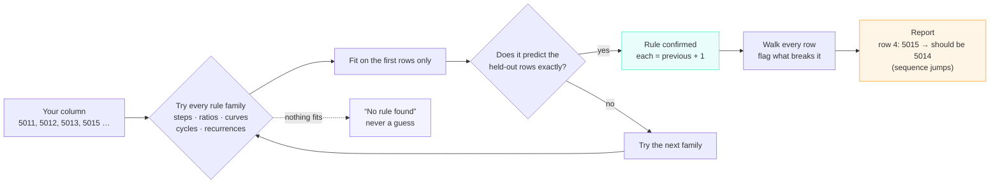
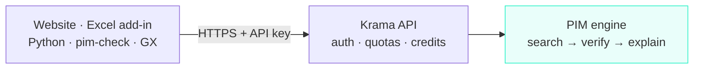

<div align="center">

<picture>
  <source media="(prefers-color-scheme: dark)" srcset="docs/readme/banner-dark.svg">
  
</picture>

<br>

[](https://pim-rules.vercel.app)
[](https://pim-rules.vercel.app/app)
[](#)

[](clients/python)
[](https://github.com/rudraneel93/Krama/actions/workflows/ci.yml)
[](SECURITY.md)
[](LICENSE)

**[Try it live](https://pim-rules.vercel.app/#demo)** · **[Start free](https://pim-rules.vercel.app/app)** · **[Docs](https://pim-rules.vercel.app/docs)** · **[Results](docs/PUBLIC_EVAL.md)** · **[What's in this repo](#whats-in-this-repo)**

</div>

---

## In one sentence

**Krama** looks at a column of numbers that *should* follow a pattern — invoice numbers, fee tables,
payment schedules, meter readings — works out the exact rule, and tells you **which rows are wrong
and what they should have been**. When there is no rule, it says so instead of guessing.

> *krama* (क्रम) is Sanskrit for **order** or **sequence**. Under the hood it runs **PIM**
> (Pattern Intelligence Model), a verified rule-discovery engine.

## How it works

<picture>
  <source media="(prefers-color-scheme: dark)" srcset="docs/readme/how-dark.svg">
  
</picture>

<details>
<summary><b>What happens inside a check?</b> (diagram)</summary>
<br>



- **No formulas from you.** Krama searches the rule types itself.
- **It checks its own answer** on rows it was not allowed to see while choosing the rule.
- **The rule you read is the rule that was tested**: a strict parser runs the exact formula it prints.
- **Two kinds of problem:** a *wrong value* (one bad row) or a *jump* (a missing or repeated
  number, after which the sequence carries on).

</details>

## See the difference

<picture>
  <source media="(prefers-color-scheme: dark)" srcset="docs/readme/before-after-dark.svg">
  
</picture>

## Who it's for

| | Use case | What Krama catches |
|---|---|---|
| 🧾 | **Finance & audit** | Missing or repeated invoice, receipt and cheque numbers before GST filing |
| 💳 | **Pricing & billing** | Fee slabs, tariff ladders and price tiers with one mistyped cell |
| 📅 | **Schedules** | Step-ups, increments and generated tables that drifted from their rule |
| 🔁 | **Operations** | Counters, rotas and meter readings that should climb evenly or repeat |
| 🛠️ | **Data teams** | Columns in pipelines that silently break their rule — with exact rows in the log |

## Why it's different

| | **Krama** | Checking by hand | Spreadsheet formulas | Data-quality tools | AI chatbots | Anomaly detectors |
|---|:---:|:---:|:---:|:---:|:---:|:---:|
| Works out the rule by itself | ✅ | 〰️ | ❌ | ❌ | 〰️ | ❌ |
| Tells you the correct value | ✅ | 〰️ | 〰️ | ❌ | 〰️ | ❌ |
| Tests its answer on your data first | ✅ | ✅ | ✅ | ✅ | ❌ | 〰️ |
| Explains in plain words | ✅ | ✅ | ❌ | 〰️ | ✅ | ❌ |
| Thousands of rows in seconds | ✅ | ❌ | ✅ | ✅ | ❌ | ✅ |
| No setup or training data | ✅ | ✅ | 〰️ | ❌ | ✅ | ❌ |

<sub>✅ yes · 〰️ partly · ❌ no. AI chatbots are known to “perceive order where none exists” in random number sequences
([Ishikawa et al., EMNLP 2025](https://preview.aclanthology.org/new-sigs/2025.findings-emnlp.681/)); Krama says “no rule found”.</sub>

## Measured, not promised

<picture>
  <source media="(prefers-color-scheme: dark)" srcset="docs/readme/results-dark.svg">
  
</picture>

Every figure comes from held-out public data; Krama was never trained on any of it.
On the 200-sequence comparison Krama answered 11 times and said “no rule” for the rest.
**Honest limits:** it recognises common rule types (not every possible pattern), it is not a
forecaster, and results on noisy data are experimental. Full methods: [docs/PUBLIC_EVAL.md](docs/PUBLIC_EVAL.md).

## Choose how you use it

| You are… | Use | Time to first result |
|---|---|---|
| Anyone with a spreadsheet | **[Website workspace](https://pim-rules.vercel.app/app)** — upload CSV/Excel or paste | 1 minute |
| An Excel user | **Excel add-in** — select a column, click *Check column* | 3 minutes |
| A developer | **REST API** or **Python client** | 5 minutes |
| A data team | **CLI in CI**, **Great Expectations**, **dbt** | 10 minutes |

<details>
<summary>🌐 <b>Website</b> — no install</summary>
<br>

1. Open **[pim-rules.vercel.app/app](https://pim-rules.vercel.app/app)** and sign in with the 6-digit code we email you.
2. **Check data** → drop a CSV/Excel file (or paste numbers).
3. Pick the column, how rows are ordered, and optionally a group (e.g. branch).
4. **Check** → rule in plain words, chart, every broken row with its sheet row number → **Download report**.

</details>

<details>
<summary>📊 <b>Excel add-in</b></summary>
<br>

1. Download the [manifest](https://pim-rules.vercel.app/excel/manifest.xml).
2. Excel → **Home → Add-ins → My add-ins → Upload my add-in** (Mac: copy it to
   `~/Library/Containers/com.microsoft.Excel/Data/Documents/wef/`).
3. Open **Check column**, paste your API key under Settings, select a column, press **Check**.
   Wrong cells turn orange.

</details>

<details>
<summary>🔌 <b>REST API</b></summary>
<br>

```bash
curl https://pim-rules.vercel.app/api/v1/check \
  -H "X-API-Key: $KRAMA_KEY" -H "Content-Type: application/json" \
  -d '{"values": [5011, 5012, 5013, 5015, 5016, 5017, 5018, 5019, 5020, 5021]}'
```

```json
{
  "status": "rule_with_breaks",
  "rule": "a[n] = a[n-1] + 1",
  "explanation": "Each element is the preceding element plus 1.",
  "breaks": [{ "index": 3, "kind": "jump", "actual": 5015, "expected": 5014 }]
}
```

Reference: [docs/API.md](docs/API.md)

</details>

<details>
<summary>🐍 <b>Python & pandas</b></summary>
<br>

```python
from pim_client import PIMClient
from pim_client.pandas import check_column

krama = PIMClient()                                   # reads PIM_API_KEY
r = krama.check(df.sort_values("invoice_no")["invoice_no"])
for b in r.breaks:
    print(b.index, b.actual, "→ should be", b.expected)

summary, broken_rows = check_column(df, "invoice_no", order_by="invoice_no", group_by="branch")
```

</details>

<details>
<summary>⚙️ <b>CLI, CI, Great Expectations, dbt</b></summary>
<br>

```bash
pim-check invoices.csv --column invoice_no --order-by invoice_no --group-by branch --fail-on-breaks
# [north] 119 rows: a[n] = a[n-1] + 1
#    line 66: 5048 but rule expects 5047 (sequence jumps)      → exit code 1 stops the pipeline
```

```python
from pim_client.gx import ExpectColumnValuesToFollowARule
suite.add_expectation(ExpectColumnValuesToFollowARule(column="invoice_no"))
```

dbt and the rest: [docs/INTEGRATIONS.md](docs/INTEGRATIONS.md)

</details>

## Plans

| Free | Starter | Growth | Scale | Pay as you go |
|:---:|:---:|:---:|:---:|:---:|
| **₹0** | **₹4,999**/mo | **₹14,999**/mo | **₹49,999**/mo | from **₹299** |
| 10 checks/day · 300/month | 25,000/month | 1,50,000/month | 10,00,000/month | 500 · 2,500 · 10,000 credits |

One check = up to 1,000 rows. Failed checks are refunded. Credits never expire. Details: [docs/PRICING.md](docs/PRICING.md)

## Trust & security

<table>
<tr>
<td width="25%" valign="top"><b>🔒 Nothing stored</b><br><sub>Values are checked in memory and never written to disk or logs.</sub></td>
<td width="25%" valign="top"><b>🔑 Keys you control</b><br><sub>Stored as hashes, shown once, revoked within 30 seconds.</sub></td>
<td width="25%" valign="top"><b>🧾 Audit trail</b><br><sub>Every answer carries a SHA-256 fingerprint of your input.</sub></td>
<td width="25%" valign="top"><b>🛡️ Tested hard</b><br><sub>OWASP ZAP, Semgrep, Bandit, Trivy, 3,000+ fuzzed requests; all findings fixed.</sub></td>
</tr>
</table>

Report a vulnerability: [SECURITY.md](SECURITY.md)

---

## What's in this repo

This repository holds everything you need to **use** Krama, released under the
[Apache-2.0 licence](LICENSE). The engine itself (PIM) runs as a hosted service.

| Folder | What it is |
|---|---|
| [`clients/python`](clients/python) | `pim-client`: Python client (standard library only), the `pim-check` CLI for CSV and CI, pandas helper, Great Expectations expectation |
| [`integrations/excel`](integrations/excel) | Excel task-pane add-in: select a column, click *Check column* |
| [`docs`](docs) | API reference, integrations, pricing, public evaluation |
| [`docs/readme`](docs/readme) · [`scripts/readme_art.py`](scripts/readme_art.py) | the animated artwork in this README and its generator |

**Open vs. hosted.** The clients, add-in, docs and evaluation write-ups are open source. The PIM engine and
the hosted service are proprietary and run at [pim-rules.vercel.app](https://pim-rules.vercel.app);
enterprise self-hosting is available on request. “Krama” and the Krama logo are trademarks of Rudraneel Das.

<details>
<summary><b>How the pieces fit</b> (diagram)</summary>
<br>



</details>

<details>
<summary><b>Install the Python client and CLI</b></summary>
<br>

```bash
pip install "git+https://github.com/rudraneel93/Krama.git#subdirectory=clients/python"
export PIM_API_KEY=pim_...                       # from pim-rules.vercel.app/app
pim-check invoices.csv --column invoice_no --order-by invoice_no
```

Optional extras: `[pandas]`, `[gx]`.

</details>

<details>
<summary><b>Develop and test</b></summary>
<br>

```bash
cd clients/python && python -m pip install -e ".[pandas]" pytest && pytest -q
node --test integrations/excel/test/logic.test.js
python integrations/excel/dev_server.py         # add-in at https://localhost:3000 (needs office-addin-dev-certs)
```

Contributions are welcome: see [CONTRIBUTING.md](CONTRIBUTING.md).

</details>

<details>
<summary><b>Research notes</b> — what the engine claims, the neural experiments, and what didn't work</summary>
<br>

**What discovery does (and does not) claim**

- **Status values are conservative**: `consistent_with_observations` (exact), `consistent_within_tolerance`
  (noisy), `refuted`, or `underdetermined`. `uniqueness_established` is always `false`.
- **Selection never sees the holdout.** The top candidate must survive the held-out tail; if it fails,
  the result says so: `1, 2, 4, 8, 16, 33` gives “no pattern” rather than “doubling”.
- **Alternatives are surfaced, not hidden**: *equivalent* (same continuation, e.g. `2a[n-1]+1` vs
  `3a[n-1]-2a[n-2]`) or *competing* (different continuation).
- **The search space is named in every explanation**: constant, arithmetic, geometric, affine recurrence,
  polynomials up to degree 5, linear recurrences up to order 6, periodic (period 2–6).

**The neural side.** PIM-0.1 also contains a PyTorch encoder with a recursive refinement cell trained
with self-supervised objectives (masked reconstruction, next step, transformation consistency,
contrastive). Measured parameter counts: PIM-S 484,271 · PIM-M 2,278,799 · PIM-L 5,584,271.
In every test so far — representation probes, learned ranking, out-of-search-space continuation and
transfer to unseen families — it did **not** beat the symbolic engine or simple baselines, so it is
**not part of the product**. The public results are summarised in [docs/PUBLIC_EVAL.md](docs/PUBLIC_EVAL.md).

**Noisy data.** The statistical engine ranks candidates by prequential (one-step-ahead) error; on rounded
loan schedules it is right within 0.05 on 81% of series, and it can name poor rules on very noisy data.
It is labelled experimental.


</details>

---

<div align="center">
<sub><b>krama</b> · every number, in its place · built in India<br>
Code in this repository: Apache-2.0. The PIM engine and the Krama name and logo: © 2026 Rudraneel Das.</sub>
</div>
